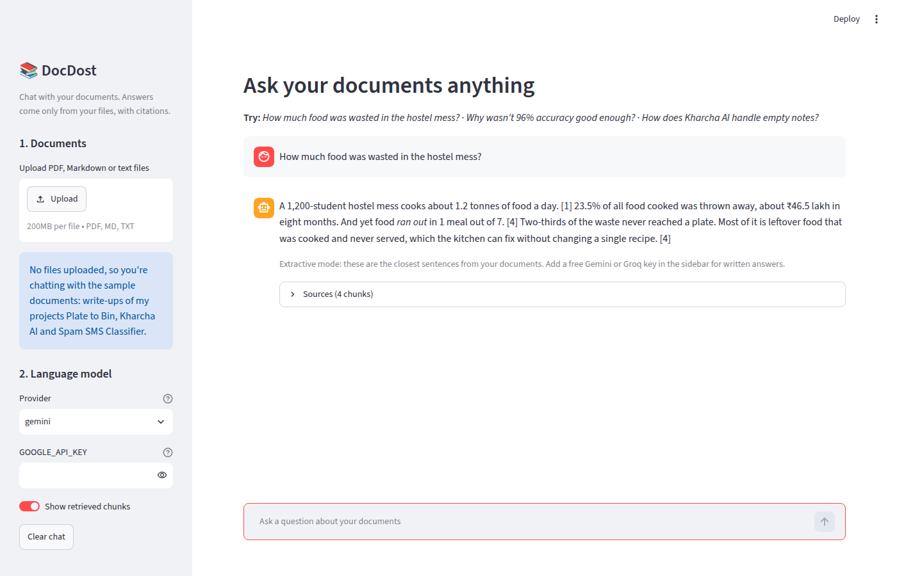
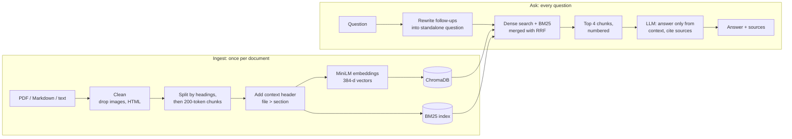
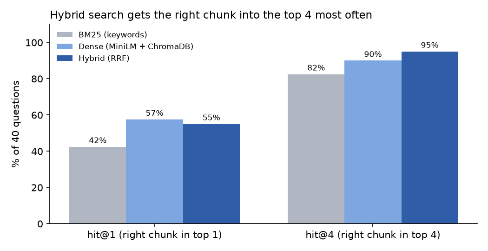

# 📚 DocDost: chat with your documents

**A RAG (Retrieval-Augmented Generation) chatbot. Upload PDFs or notes, ask questions in plain English, and get answers taken only from your files, with citations.**


*Dost* means "friend" in Hindi.

---

## The problem

LLMs like Gemini or Llama are good at writing, but they don't know what's in *your* documents, and when they don't know, they often make something up.
RAG fixes this: first **search** your documents for the passages that matter, then ask the LLM to **answer only from those passages** and cite them.
If the answer isn't there, DocDost says so instead of guessing.


*The Streamlit app. With no upload, it answers questions about the bundled sample documents: write-ups of my other projects.*

---

## How it works



| Step | What I used | Why |
|---|---|---|
| Loading | `pypdf`, plain text, Markdown | PDFs are split per page so citations can say "page 3" |
| Chunking | LangChain `MarkdownHeaderTextSplitter` + `RecursiveCharacterTextSplitter` measured in **tokens** | A chunk never mixes two sections, and never exceeds what the embedding model can read (see below) |
| Embeddings | `all-MiniLM-L6-v2` via ONNX Runtime | Free, runs on CPU without PyTorch, 384 dimensions |
| Vector database | **ChromaDB** (cosine distance), persisted to disk | Simple, local, no server needed |
| Keyword search | BM25 (`rank_bm25`) | Catches exact terms embeddings blur, like `0.81` or `RANK()` |
| Fusion | Reciprocal Rank Fusion, written from scratch | Merges two rankings without having to compare BM25 scores to cosine similarities |
| Generation | LangChain chat models: **Gemini** or **Groq (Llama 3.1)**, both free tier, or local **Ollama** | Swappable with one setting; temperature 0 for factual answers |
| Chat memory | Follow-ups ("and how much did it save?") are rewritten into standalone questions before searching | Otherwise the retriever has nothing to search for |
| No API key? | Extractive mode: returns the most relevant sentences from the retrieved chunks | The app always works, even offline |

---

## Results: measuring retrieval

If retrieval misses the right passage, even a perfect LLM can't answer. So I measured retrieval first.

I wrote **40 test questions** about the sample documents (`eval/questions.csv`). For each one I recorded the short phrase a correct answer needs, like `23.5% of all food cooked`.
A retrieval counts as a **hit** if one of the returned chunks contains that phrase. 14 of the questions are deliberately **paraphrased** so they share few words with the answer ("When do students skip the morning meal?" vs "only ~30% turn up on Saturday and Sunday mornings").



| Retriever | hit@1 | hit@4 | MRR@4 | hit@4, keyword questions | hit@4, paraphrased questions |
|---|---:|---:|---:|---:|---:|
| BM25 (keyword baseline) | 42.5% | 82.5% | 0.59 | 92.3% | 64.3% |
| Dense (MiniLM + ChromaDB) | **57.5%** | 90.0% | 0.71 | 92.3% | 85.7% |
| **Hybrid (both, RRF)** | 55.0% | **95.0%** | **0.72** | **100%** | 85.7% |

- **Embeddings understand meaning:** on paraphrased questions, dense search finds the right chunk 86% of the time, against 64% for keywords.
- **Hybrid is the most reliable:** the right chunk is in the top 4 for 38 of 40 questions, which is what matters since the LLM reads all 4.
- **Dense alone is slightly better at rank 1** (57.5% vs 55%), so hybrid isn't better at everything. With 40 questions, a 1-question gap is noise.

### Two fixes the evaluation found

**1. Chunks were silently cut off.** My first version split text every 800 *characters*. When I counted *tokens* (see the notebook), 6 of 49 chunks were longer than the 256 tokens the embedding model reads, so their endings were never searched. Tables and numbers use more tokens per character than prose. I switched to splitting by token count with the model's own tokenizer, and a test now checks that every chunk fits.

**2. Chunks lost their context.** A chunk like `| ML: note only | 82.8% |` doesn't say which project it's about. Adding a one-line header (`kharcha_ai.md > Kharcha AI > Results at a glance`) to every chunk before embedding raised hybrid hit@4 from 85% to 95% at the same chunk size:

| Chunk size (tokens) | Hybrid hit@4, no header | Hybrid hit@4, with header |
|---:|---:|---:|
| 64 | 70.0% | 80.0% |
| 128 | 77.5% | 85.0% |
| **200** | 85.0% | **95.0%** |

*Full grid (3 chunk sizes × header on/off × 3 retrievers) in `reports/chunking_experiments.csv`.*

---

## Understanding the model: tokens, embeddings, attention

[`notebooks/01_tokens_embeddings_attention.ipynb`](notebooks/01_tokens_embeddings_attention.ipynb) opens up the model DocDost uses:

- **Tokenization:** how WordPiece splits `zmto biryani 🍕` into `z ##mt ##o bi ##rya ##ni [UNK]`, and the token count check that found fix #1.
- **Embeddings:** a cosine-similarity heatmap showing a question is closer to its paraphrased answer than to unrelated sentences.
- **Attention from scratch in NumPy:** scaled dot-product attention, softmax, and the causal mask, with bidirectional (encoder, like MiniLM) vs causal (decoder, like GPT) attention side by side.

---

## Run it yourself

```bash
git clone https://github.com/aryan-novice/doc-dost.git
cd doc-dost
pip install -r requirements.txt

python -m docdost.cli ingest                 # index data/docs (downloads the ~80 MB embedding model once)
python -m docdost.cli ask "How much food was wasted in the hostel mess?"
python -m docdost.cli chat                   # multi-turn chat with follow-up questions
streamlit run app/app.py                     # the web app: upload your own PDFs

python eval/evaluate.py                      # retrieval metrics + chart
pytest -q                                    # 12 tests, no API key needed
```

**For written answers, add a free API key** (without one, DocDost runs in extractive mode):

```bash
export GOOGLE_API_KEY=...    # free at https://aistudio.google.com/apikey
# or
export GROQ_API_KEY=...      # free at https://console.groq.com/keys
```

In the app you can paste the key in the sidebar instead. To use your own documents from the command line, run `python -m docdost.cli ingest path/to/folder`.

---

## Project structure

```
doc-dost/
├── app/app.py                    # Streamlit chat app (upload files, chat, see sources)
├── docdost/
│   ├── config.py                 # chunk size, top-k, LLM providers
│   ├── loaders.py                # load PDF/MD/TXT, clean, token-based chunking
│   ├── embeddings.py             # MiniLM (ONNX) embeddings + token counter
│   ├── retriever.py              # ChromaDB + BM25 + reciprocal rank fusion
│   ├── rag.py                    # prompt, LLM call, citations, follow-ups, extractive fallback
│   └── cli.py                    # ingest / ask / chat commands
├── data/docs/                    # sample documents (my project write-ups)
├── eval/
│   ├── questions.csv             # 40 test questions with expected evidence
│   ├── evaluate.py               # hit@k and MRR for each retriever
│   └── experiments.py            # chunk size × header × retriever grid
├── notebooks/
│   └── 01_tokens_embeddings_attention.ipynb
├── reports/                      # metrics JSON/CSV and charts
└── tests/test_docdost.py
```

---

## Limitations and next steps

- **The test set is small and I tuned on it.** 40 questions about 4 documents, and the same questions were used to pick the chunk size and headers. The numbers show which ideas help, not how DocDost would score on someone else's documents. Next: a separate held-out question set.
- **Generated answers aren't scored yet.** I measured retrieval, not the LLM's answers. Next: check faithfulness (is every sentence supported by a cited chunk?) using an LLM-as-judge or RAGAS.
- **Scanned PDFs** have no text layer and need OCR first.
- **English-first embeddings.** MiniLM splits Hinglish words into meaningless pieces (see the notebook). A multilingual model like `multilingual-e5-small` would suit Indian documents better.
- **Next:** a cross-encoder re-ranker for better rank-1 accuracy, and streaming answers in the app.

---

## Author

**Aryan Raj** · [GitHub](https://github.com/aryan-novice) · [LinkedIn](https://www.linkedin.com/in/aryan-raj-4b0301374)

See also: [kharcha-ai](https://github.com/aryan-novice/kharcha-ai) (NLP spend categorizer) · [plate-to-bin](https://github.com/aryan-novice/plate-to-bin) (food-waste analysis with SQL) · [spam-sms-classifier](https://github.com/aryan-novice/spam-sms-classifier)

Licensed under MIT.
