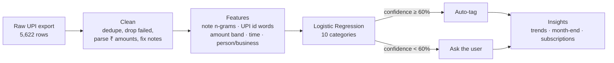

# 💸 Kharcha AI: what did I actually spend on?

**An NLP model that reads messy UPI payment notes, tags every payment with a spend category, and turns a year of payments into money insights.**


---

## The problem

Open any UPI app and scroll through your history:

```
₹40      paid to 9876543210@ybl         note: (empty)
₹289     paid to zomato.order@hdfcbank  note: "zmto biryani 🍕"
₹12,000  paid to ramesh.k@oksbi         note: "rent oct"
₹1,400   paid to 9988776655@paytm       note: "goa trip"
₹30      paid to 7012345678@axl         note: "chai bhaiya"
```

The app tells you **who** you paid, not **what for**. Was that ₹40 chai, an auto ride, or money to a friend?
1 in 6 payments has no note at all, and the rest are typos, Hinglish and emojis. So most people never find out where their salary or pocket money actually goes.

**Kharcha AI** (*kharcha* means "expense" in Hindi) fixes that:

1. **Tags** every payment into one of 10 categories, using the note, the payee's UPI id, the amount and the time.
2. **Knows when it's unsure.** It auto-tags only when it's at least 60% confident and asks you about the rest.
3. **Explains the money:** where it goes, month-end crunches, late-night food habits, and every subscription you're paying for.


*The Streamlit app: pick a sample person or upload your own UPI CSV.*

---

## Results at a glance

| Approach | Accuracy | Macro F1 | Accuracy when the note is **empty** |
|---|---:|---:|---:|
| Keyword rules (baseline) | 83.1% | 80.8% | 66.5% |
| ML: note only (TF-IDF + Logistic Regression) | 82.8% | 82.7% | 35.4% |
| **ML: note + payee + amount + time (final)** | **95.3%** | **94.0%** | **90.0%** |

*Tested on the last 3 months (Jul-Sep 2026, 1,298 payments). The model was trained only on the 9 months before that.*

- **Human in the loop:** the model auto-tags **96%** of payments at **97.3%** accuracy and sends the other 4% to you for review.
- **The model finds bad labels:** of the 22 test "mistakes" where the model was ≥90% confident, **20 were actually wrong labels** in the data. Fixing those, the model's true accuracy is about 97%.
- **Subscription detector:** found all **30** recurring payments (rent, Wi-Fi, gym, recharges, Netflix/Spotify/ChatGPT) with **zero** false alarms.


---

## What the money says

Insights from 6 young people (students, interns and first-job freshers) over 12 months and 5,400+ payments.

| | Finding |
|---|---|
| 🏠 | **Rent eats 34%** of all spending. Food is a distant second at 14.5%. |
| 📉 | **Month-end crunch:** day-to-day spending drops **25%** after the 24th (₹212/day vs ₹284/day). |
| 🌙 | **Late-night food** is only 11% of food orders but 14% of food money. A late-night order averages ₹205, versus ₹160 in the day. |
| 🪔 | **Diwali effect:** shopping in Oct-Nov is **2.3×** a normal month. |
| ☕ | **Tiny payments:** 36% of payments are under ₹100 but add up to only 3.7% of the money. Chai alone is about 69 payments and ₹3,100 a year per person. |

<p>


</p>
<p>


</p>

---

## How it works



### The features, and why each one helps

| Feature | Example | Why it helps |
|---|---|---|
| Note, as character 2-4 grams | `zmto` and `zomato` share `zo`, `om`, `to`... | Survives typos and Hinglish ("sabji" vs "sabzi") |
| Words in the payee's UPI id | `zomato.order@hdfcbank` → `zomato order hdfcbank` | Works even when the note is empty |
| Amount band | under ₹50 / ₹50-150 / ... / ₹5,000+ | ₹20 is chai, ₹12,000 is rent |
| Time of day | morning / afternoon / evening / late night | 11pm payments are mostly food delivery |
| Person or business? | `9876543210@ybl` is a person | Splits friends, auto drivers and chai stalls from brands |

### Where it still gets confused


The hardest cases are honestly ambiguous: a "cab split" sent to a friend (Transport, or Friends & Family?), or a local shop paid on a personal UPI id.

---

## The dataset

Real UPI statements are private, so `src/generate_data.py` **simulates** 12 months of UPI payments (Oct 2025 - Sep 2026) for 6 people in 6 Indian cities:

| Person | City | Monthly spend | Biggest non-rent category |
|---|---|---:|---|
| Hostel student | Pune | ₹19.5k | Food & Dining |
| Fresher, IT job | Bengaluru | ₹38.7k | Food & Dining |
| PG intern | Hyderabad | ₹28.7k | Food & Dining |
| MBA student | Delhi | ₹38.9k | Food & Dining |
| Fresher, govt exam prep | Jaipur | ₹19.0k | Groceries |
| Fresher, analyst | Mumbai | ₹39.6k | Transport |

It copies the mess of a real statement on purpose, so there is real cleaning work to do:

- notes that are empty (16%), lazy ("ok", "paid"), misspelt ("swigy", "recharj"), Hinglish ("doodh wala") or full of emojis
- amounts stored as text in 3 formats: `1250`, `₹1,250.00`, `Rs. 1250`
- failed transactions, duplicate rows, and **~2% wrong labels** (people tag in a hurry)
- chai stalls, auto drivers and sabzi walas paid on personal UPI ids, just like real life

**Columns:** `txn_id, user_id, persona, city, timestamp, amount, direction, payee_vpa, note, status, category`

> The seed is fixed (`SEED = 42`), so every run gives exactly the same data and results.

---

## Run it yourself

```bash
git clone https://github.com/aryan-novice/kharcha-ai.git
cd kharcha-ai
pip install -r requirements.txt

python run_pipeline.py          # generate → clean → train → insights (~15 seconds)
streamlit run app/app.py        # open the app in your browser
pytest -q                       # 15 tests
```

Tag a single payment from the terminal:

```bash
python src/predict.py --note "zmto biryani" --vpa zomato.order@hdfcbank --amount 289
# Category   : Food & Dining
# Confidence : 100%

# no note, paid to a phone number, ₹30 at 8am... probably morning chai
python src/predict.py --note "" --vpa 9876543210@ybl --amount 30 --hour 8
# Category   : Food & Dining
# Confidence : 77%
# Top guesses: Food & Dining 77%, Education 9%, Friends & Family 7%
```

**The app** lets you pick any of the 6 people, or upload your own CSV (`timestamp, amount, payee_vpa, note`; try `data/sample_upload.csv`). It shows where the money goes, month-by-month spending, the review queue of low-confidence payments, and detected subscriptions.

---

## Project structure

```
kharcha-ai/
├── app/app.py                    # Streamlit app
├── data/
│   ├── raw/                      # simulated UPI export + label-noise answer key (audit only)
│   ├── processed/                # cleaned data
│   └── sample_upload.csv         # try this in the app
├── models/kharcha_model.joblib   # trained pipeline
├── notebooks/
│   └── kharcha_walkthrough.ipynb # the full story, step by step
├── reports/
│   ├── figures/                  # all charts
│   ├── metrics.json              # model scores
│   ├── classification_report.txt
│   ├── error_samples.csv         # the model's mistakes, for error analysis
│   ├── subscriptions.csv         # detected recurring payments
│   └── insights.json
├── src/
│   ├── generate_data.py          # 1. simulate UPI data
│   ├── clean_data.py             # 2. clean it
│   ├── features.py               #    feature engineering + model pipeline
│   ├── rules.py                  #    keyword-rules baseline
│   ├── train.py                  # 3. train, evaluate, save model
│   ├── insights.py               # 4. money insights + charts
│   ├── predict.py                #    tag one payment (CLI)
│   └── plot_style.py             #    shared chart style
├── tests/test_pipeline.py
└── run_pipeline.py               # runs steps 1-4
```

---

## Limitations and next steps

- **Simulated data.** The patterns are realistic but planted. The next step is testing on real, consented, anonymised statements.
- **One shared model.** A per-user layer would learn that *your* `9876543210@ybl` is your auto driver.
- **Next:** budget alerts ("you've spent 80% of your food budget by the 18th"), PDF statement parsing, and a multilingual note model for regional languages.

---

## Author

**Aryan Raj** · [GitHub](https://github.com/aryan-novice) · [LinkedIn](https://www.linkedin.com/in/aryan-raj-4b0301374)

See also: [plate-to-bin](https://github.com/aryan-novice/plate-to-bin) (hostel food-waste analysis with SQL and a dashboard) · [spam-sms-classifier](https://github.com/aryan-novice/spam-sms-classifier)

Licensed under MIT.
